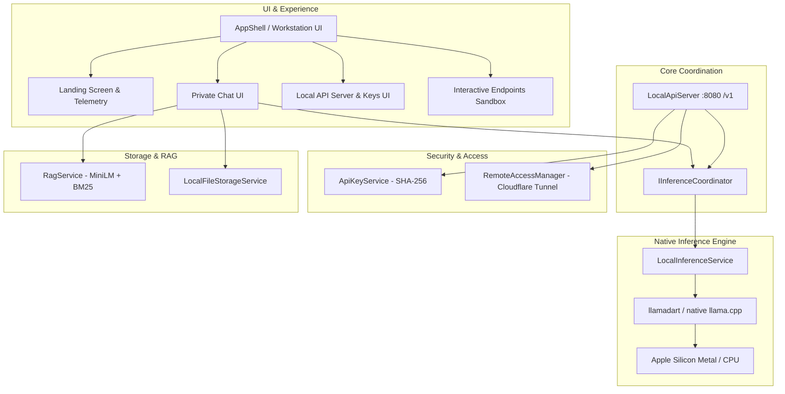

<div align="center">

# 🧠 Sovereign AI — Personal Local LLM & API Server
### *Private, Air-Gapped GGUF Inference Workstation & OpenAI-Compatible Local/Remote API Server for macOS*

<p align="center">
  
  
  
  
  
  
</p>

---

</div>

## 📖 Overview

**Sovereign AI** transforms your Mac into an autonomous, private AI workstation and high-performance **OpenAI-compatible HTTP API server**.

Running natively on Apple Silicon (Metal) and Intel CPUs via native C++ bindings to `llama.cpp` (`llamadart`), Sovereign AI enables you to chat with local GGUF models, index and chat with documents via Hybrid Neural RAG, and serve `/v1/chat/completions` directly to tools like **Cursor**, **Continue.dev**, **LangChain**, **AutoGen**, and your own scripts—completely offline with zero cloud telemetry.

### 🚫 Core Guarantees:
- ❌ **Zero Cloud Telemetry**: Prompts, weights, document embeddings, and completions never leave your machine.
- ❌ **No External Daemons**: No Docker containers or external Ollama processes required. Everything runs inside the single native app.
- ❌ **No Duplicate Memory Overhead**: The shared inference coordinator routes both in-app UI chat and external HTTP API requests through a single in-memory model runtime.

---

## ✨ Key Features

```
┌────────────────────────────────────────────────────────────────────────┐
│  ⚡ Local GGUF Engine       🌐 OpenAI HTTP Server    🛡️ Scoped API Keys │
│  Native llama.cpp via Metal  Drop-in /v1 endpoints    SHA-256 hashed    │
│  Apple Silicon GPU & CPU     Cursor & Continue ready  Rate & Concurrency│
│                                                                        │
│  📶 LAN External Mode       ☁️ Cloudflare Tunnels    🔍 Hybrid Neural RAG│
│  0.0.0.0 binding for LAN    Instant public HTTPS     Dense vector + BM25│
│  Smooth zero-drop rebind    Zero port forwarding     PDF, DOCX, TXT chat│
│                                                                        │
│  🖥️ Landing Screen          🧪 Test Sandbox          🖤 OLED Black UI   │
│  Live hardware telemetry    Interactive endpoints    Linear/obsidian    │
│  Quick prompt launchpad     Live SSE test runner     No purple tint     │
└────────────────────────────────────────────────────────────────────────┘
```

- **⚡ Native GGUF Inference**: Metal GPU accelerated runtime supporting Llama 3, Qwen 2.5, Mistral, Gemma 2, SmolLM, and any standard `.gguf` model.
- **🌐 OpenAI-Compatible Local HTTP API Server**:
  - Full support for `GET /health`, `GET /v1/models`, and `POST /v1/chat/completions`.
  - Both standard JSON responses and real-time Server-Sent Events (SSE `stream: true`) token streaming with `[DONE]` terminator.
- **📶 Allow External Connections (LAN Mode)**:
  - Toggle between strict loopback (`127.0.0.1`) and LAN interface (`0.0.0.0`).
  - Automatic resolution and display of the Mac's real local network IP (e.g., `http://192.168.1.10:8080`).
  - Bulletproof socket rebinding with zero running-state drops.
- **🔑 Keyless Localhost Mode (Ollama-style)**:
  - Toggle on to query the server from your Mac without an API key (like Ollama).
  - External and remote tunnel requests still strictly enforce API key authentication.
- **🛡️ Cryptographic API Key Management**:
  - PBKDF2 with SHA-256 key hashing with salt. Raw secret keys are displayed only once upon creation (`sk-sov-...`).
  - Granular permissions (`chat.completions`, `models.list`), rate limits (RPM), and concurrency quotas.
- **☁️ Cloudflare HTTPS Quick Tunnels**:
  - Expose your Mac API to external authorized devices over secure temporary HTTPS URLs without port forwarding or router configuration.
- **🧪 Interactive Sample Endpoints Sandbox**:
  - In-app test client to test `/v1/models` and `/v1/chat/completions` live with response timing, HTTP status codes, and headers.
- **🔍 Hybrid Neural RAG (MiniLM-L6-v2 + BM25)**:
  - Ingest PDF, DOCX, TXT, CSV, JSON, and LOG files.
  - Combines 384-dimensional dense semantic vectors with lexical BM25 using Reciprocal Rank Fusion ($k=60$) for verifiable citations.
- **🖤 Obsidian / OLED Jet Black Aesthetic**:
  - Refined modern dark theme (`#000000`, `#09090B`, `#0F0F12`, `#141418`, `#242428`) with emerald status indicators and clean chrome white typography.

---

## 🏗 System Architecture



---

## 💻 Prerequisites

Before cloning and building, ensure your environment has:

| Tool | Version Requirement | Notes |
| :--- | :--- | :--- |
| **macOS** | `13.0+` (Ventura, Sonoma, Sequoia) | Apple Silicon (M1/M2/M3/M4) or Intel |
| **Flutter SDK** | `>= 3.24.0` (Recommended: `3.24.x` / `3.27.x`) | `flutter doctor -v` |
| **Dart SDK** | `>= 3.5.0` (Bundled with Flutter) | |
| **Xcode** | `15.0+` with Command Line Tools | `xcode-select --install` |
| **CocoaPods** | `>= 1.14.0` | `sudo gem install cocoapods` or `brew install cocoapods` |
| **cloudflared** *(Optional)* | Latest | `brew install cloudflared` (for HTTPS tunnels) |

---

## 🚀 How to Clone and Resume the Project

Follow these steps to clone the project from scratch and run it immediately on your Mac:

### 1. Clone the Repository
```bash
git clone https://github.com/sdmazaharmehadi7/Your-Personal-LLM-API-Server.git
cd Your-Personal-LLM-API-Server
```

### 2. Verify Flutter Setup
```bash
flutter doctor -v
```

### 3. Install Dependencies
```bash
flutter pub get
```

### 4. Run Code Analysis & Test Suite
Verify that all 157 automated tests pass:
```bash
flutter analyze
flutter test
```

### 5. Launch in Development Mode
```bash
flutter run -d macos
```

### 6. Build macOS Release Binary
To compile an optimized native `.app` bundle:
```bash
flutter build macos --release
```
The built executable will be located at:
```bash
open build/macos/Build/Products/Release/sovereign_ai.app
```

---

## 🔌 Using the Local API Server

Once the server is started in the app (default port: `8080`), you can query it with standard OpenAI tooling.

### 1. Check Server Health
```bash
curl http://127.0.0.1:8080/health
```
**Response:**
```json
{
  "status": "ok",
  "model_loaded": true,
  "model": "smollm2-135m-instruct-q4_k_m.gguf",
  "version": "1.0.0",
  "uptime_seconds": 128
}
```

### 2. List Models (`/v1/models`)
```bash
curl http://127.0.0.1:8080/v1/models \
  -H "Authorization: Bearer <YOUR_API_KEY>"
```
*(Note: If **Keyless Localhost Access** is enabled, the `Authorization` header is optional when connecting from `127.0.0.1`)*.

### 3. Chat Completions (Non-Streaming)
```bash
curl -X POST http://127.0.0.1:8080/v1/chat/completions \
  -H "Content-Type: application/json" \
  -H "Authorization: Bearer <YOUR_API_KEY>" \
  -d '{
    "model": "smollm2-135m-instruct-q4_k_m.gguf",
    "messages": [
      {"role": "system", "content": "You are a helpful assistant."},
      {"role": "user", "content": "Explain quantum computing in one sentence."}
    ],
    "temperature": 0.7,
    "max_tokens": 100
  }'
```

### 4. Chat Completions (Streaming Server-Sent Events)
```bash
curl -N -X POST http://127.0.0.1:8080/v1/chat/completions \
  -H "Content-Type: application/json" \
  -H "Authorization: Bearer <YOUR_API_KEY>" \
  -d '{
    "model": "default",
    "messages": [
      {"role": "user", "content": "Count from 1 to 5."}
    ],
    "stream": true
  }'
```

---

## 🐍 Python & JavaScript Integration

### Python (`openai` package)
```python
from openai import OpenAI

client = OpenAI(
    base_url="http://127.0.0.1:8080/v1",
    api_key="your-api-key-here"  # Or "localhost" if keyless access is enabled
)

response = client.chat.completions.create(
    model="active-model",
    messages=[
        {"role": "system", "content": "You are an expert coder."},
        {"role": "user", "content": "Write a quicksort function in Python."}
    ],
    stream=True
)

for chunk in response:
    content = chunk.choices[0].delta.content
    if content:
        print(content, end="", flush=True)
print()
```

### Node.js / TypeScript (`openai` package)
```typescript
import OpenAI from 'openai';

const client = new OpenAI({
  baseURL: 'http://127.0.0.1:8080/v1',
  apiKey: 'your-api-key-here',
});

async function main() {
  const stream = await client.chat.completions.create({
    model: 'active-model',
    messages: [{ role: 'user', content: 'Say hello from TypeScript!' }],
    stream: true,
  });

  for await (const chunk of stream) {
    process.stdout.write(chunk.choices[0]?.delta?.content || '');
  }
}

main();
```

---

## 🛠 Integrating with IDEs

### Cursor / Continue.dev Setup
Configure your local API server as a custom OpenAI provider:
- **Provider**: `OpenAI`
- **Base URL**: `http://127.0.0.1:8080/v1`
- **Model Name**: Use the model filename currently loaded in Sovereign AI (or `default`)
- **API Key**: Enter an API key generated from Sovereign AI's Settings screen (or any placeholder if Keyless Localhost is enabled)

---

## 📂 Project Directory Structure

```text
Your-Personal-LLM-API-Server/
├── macos/                     # macOS native runner (Metal entitlements & network client/server)
├── lib/
│   ├── core/                  # Design tokens, theme, typography, color schemes
│   │   ├── theme/             # OLED jet black color schemes & AppTheme
│   │   └── constants/         # Default ports, URLs, limits
│   ├── models/                # Typed models
│   │   ├── api_key.dart       # API key metadata, permissions, hashes
│   │   ├── chat_message.dart  # Message structure and roles
│   │   └── local_model.dart   # GGUF catalog and download specifications
│   ├── services/
│   │   ├── api_server/        # HTTP API Server implementation
│   │   │   ├── local_api_server.dart   # OpenAI HTTP router, SSE stream, LAN rebind
│   │   │   └── api_key_service.dart    # SHA-256 API key storage & rate limiter
│   │   ├── inference_coordinator.dart  # Authoritative shared model locking
│   │   ├── inference_service.dart      # llamadart GGUF runtime
│   │   ├── remote_access/     # Cloudflare HTTPS Quick Tunnel manager
│   │   ├── rag/               # Hybrid RAG (MiniLM dense + BM25 lexical)
│   │   └── storage_service.dart # Atomic JSON persistence
│   ├── state/                 # Listenable state (ChatState, ModelState, SettingsState)
│   ├── ui/
│   │   ├── landing/           # Hardware workstation landing screen & prompt bar
│   │   ├── chat/              # Private chat interface & streaming bubbles
│   │   ├── models/            # In-app GGUF downloader & disk importer
│   │   ├── settings/          # Local API server, LAN toggle, key manager, tunnels
│   │   │   ├── sample_endpoints_screen.dart # Interactive HTTP testing sandbox
│   │   │   └── widgets/       # api_server_card.dart, api_keys_card.dart
│   │   └── shell/             # Responsive NavigationRail & Drawer
│   └── main.dart              # Dependency injection & entry point
├── test/                      # 157 automated unit, widget, and integration tests
│   ├── api_server_test.dart   # Comprehensive HTTP API router & SSE tests
│   ├── api_key_auth_test.dart # Cryptographic auth, rate limits & permissions
│   ├── rebind_test.dart       # Socket rebind & LAN toggle tests
│   └── widget_test.dart       # Landing screen & UI navigation tests
└── pubspec.yaml               # Dependencies & assets
```

---

## 🧪 Testing & Quality Assurance

Run the comprehensive test suite to verify all components:
```bash
# Run all tests (157 unit, integration, and widget tests)
flutter test

# Run HTTP API server tests specifically
flutter test test/api_server_test.dart

# Run API key authentication & permissions tests
flutter test test/api_key_auth_test.dart

# Run LAN rebind tests
flutter test test/rebind_test.dart

# Code formatting & static analysis
dart format --output=none --set-exit-if-changed .
flutter analyze
```

---

## 🔒 Security Architecture

1. **Local-Only Binding by Default**: Binds strictly to loopback `127.0.0.1`. Remote network interfaces cannot access the server unless explicitly enabled.
2. **Explicit LAN Permission & Warning**: Enabling "Allow External Connections" binds to `0.0.0.0` and clearly displays client URLs and network security notices.
3. **Cryptographic Key Hashing**: API keys are generated as cryptographically random tokens (`sk-sov-...`) and salted with PBKDF2/SHA-256 before storage.
4. **Untrusted Prompt Isolation**: RAG document extractions are isolated with delimiter boundaries to protect against prompt injection.
5. **No Telemetry**: No tracking, phone-home calls, analytics SDKs, or third-party cloud dependencies.

---

## 📄 License

This project is licensed under the **Apache License 2.0**. See the [LICENSE](LICENSE) file for details.

---

<div align="center">
  <b>Built with ❤️ for privacy, developer autonomy, and personal sovereign AI.</b>
</div>
